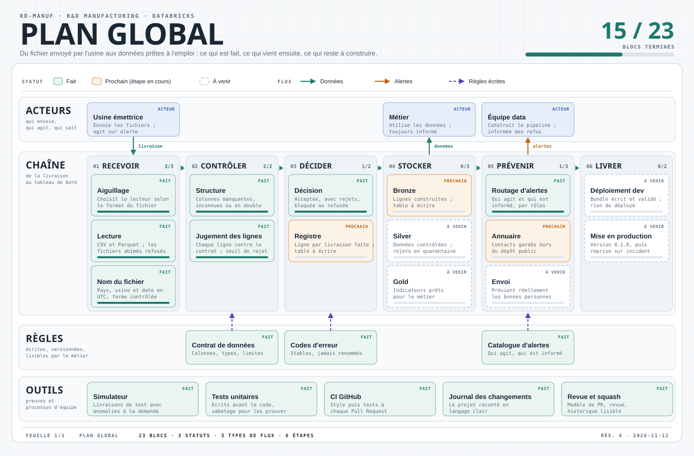

# rd-manuf

Pipeline de données **R&D Manufacturing** sur Databricks (architecture médaillon bronze → silver → gold),
construit pas à pas avec un processus d'équipe : branches, Pull Requests, CI GitHub Actions et revue de code.

## En clair

Des usines envoient des fichiers de données de production, appelés « livraisons ». Ce projet vérifie chaque livraison avant de s'en servir :
le fichier est-il lisible, a-t-il les bonnes colonnes, chaque valeur respecte-t-elle les règles prévues ?
Une ligne incorrecte est écartée au lieu d'être utilisée, une livraison trop abîmée est refusée,
et le projet détermine qui doit agir (l'usine émettrice, le métier ou l'équipe data) et qui doit seulement être informé.
Les règles sont écrites dans un « contrat de données », un fichier lisible par le métier.

<p align="center">
  
</p>

## Plan global

🚧 Projet en construction. 🟢 fait · 🟠 prochain · ⚪ à venir. Cliquez sur une étape pour la déplier : les blocs terminés renvoient vers le code.

<details>
<summary><b>01 · Recevoir</b> : lire le fichier de l'usine</summary>

- 🟠 **Aiguillage** : choisira le lecteur (CSV ou Parquet) selon l'extension du fichier.
- 🟢 **Lecture** ([`lecture.py`](src/rd_manuf/lecture.py)) : lit les fichiers CSV et Parquet ; un fichier abîmé, coupé ou mal encodé est refusé proprement.
- ⚪ **Nom du fichier** : pays, usine et date en UTC, avec une forme contrôlée.

</details>

<details>
<summary><b>02 · Contrôler</b> : la structure, puis chaque ligne</summary>

- 🟢 **Structure** ([`structure.py`](src/rd_manuf/structure.py)) : colonnes manquantes, inconnues ou en double, fichier vide.
- 🟢 **Jugement des lignes** ([`contrat.py`](src/rd_manuf/contrat.py)) : chaque ligne est vérifiée contre le contrat ; une ligne incorrecte est écartée, et une livraison dont trop de lignes sont écartées est bloquée (seuil de rejet).

</details>

<details>
<summary><b>03 · Décider</b> : une décision unique par livraison</summary>

- 🟢 **Décision** ([`reception.py`](src/rd_manuf/reception.py)) : acceptée, acceptée avec rejets, bloquée ou refusée.
- 🟠 **Registre** : une ligne par livraison, avec sa décision et son heure d'arrivée.

</details>

<details>
<summary><b>04 · Stocker</b> : bronze, silver, gold</summary>

- 🟠 **Bronze** : les données telles que reçues, conservées.
- ⚪ **Silver** : les données contrôlées ; les lignes rejetées vont en quarantaine pour être corrigées.
- ⚪ **Gold** : des indicateurs prêts à l'emploi pour le métier.

</details>

<details>
<summary><b>05 · Prévenir</b> : qui agit, qui est informé</summary>

- 🟢 **Routage d'alertes** ([`alertes.py`](src/rd_manuf/alertes.py), [`catalogue.yaml`](contracts/alertes/catalogue.yaml)) : pour chaque problème, le rôle qui doit agir et ceux qui sont informés. Des rôles, jamais des noms de personnes.
- 🟠 **Annuaire** : les contacts, gardés hors du dépôt public.
- ⚪ **Envoi** : prévenir réellement les bonnes personnes (rien n'est encore envoyé).

</details>

<details>
<summary><b>06 · Livrer</b> : du bac à sable à la production</summary>

- ⚪ **Déploiement dev** : mise en place sur Databricks.
- ⚪ **Mise en production** : version 0.1.0, puis reprise sur incident.

</details>

<details>
<summary><b>Règles écrites et outils</b> : ce qui garantit la qualité</summary>

- 🟢 **Contrat de données** ([`livraison_production.yaml`](contracts/data/livraison_production.yaml)) : colonnes, types, limites et règles, lisibles par le métier.
- 🟢 **Codes d'erreur** : stables, jamais renommés, car les alertes s'appuient dessus.
- 🟢 **Simulateur** ([`simulateur.py`](src/rd_manuf/simulateur.py)) : fabrique des livraisons de test avec des anomalies demandées, pour tester et rejouer un incident.
- 🟢 **Tests, CI et revue** ([`tests/unitaires/`](tests/unitaires/), [`.github/`](.github/)) : les tests s'écrivent avant le code, la CI les relance à chaque Pull Request.
- 🟢 **Journal des changements** ([`CHANGELOG.md`](CHANGELOG.md)) : le projet raconté pas à pas, en langage clair.

</details>

## Environnements (catalogues Unity Catalog)

| Environnement | Catalogue | Rôle |
|---|---|---|
| playground | `rd_manuf_playground` | Tests destructifs et scénarios libres |
| dev | `rd_manuf_dev` | Intégration sur les livraisons rejouées de la prod |
| prod | `rd_manuf_prod` | Production |

## Principe

Le dépôt contient le **code** ; les catalogues contiennent les **données**. Le même code tourne partout :
l'environnement se choisit par le paramètre `catalogue`, jamais par une copie de dossier.

## Organisation du dépôt

- [`contracts/data/`](contracts/data/) : le contrat de données de la livraison de production (colonnes, types, limites, règles).
- [`contracts/alertes/`](contracts/alertes/) : pour chaque code d'erreur, le rôle qui agit et ceux qui sont informés.
- [`src/rd_manuf/`](src/rd_manuf/) : le code.
  - `contrat.py` : chargement du contrat, contrôle des lignes et des livraisons, codes d'erreur ;
  - `structure.py` : contrôle de l'en-tête d'une livraison ;
  - `reception.py` : la décision unique sur une livraison ;
  - `alertes.py` : le routage des alertes selon le catalogue ;
  - `lecture.py` : lecture des fichiers CSV et Parquet ;
  - `simulateur.py` : fabrication de livraisons de test ;
  - `config.py` : garde-fou sur le choix de l'environnement.
- [`tests/unitaires/`](tests/unitaires/) : les tests.
- [`.github/`](.github/) : la CI et le modèle de description des Pull Requests.

## Installer et lancer les tests

Il faut Python 3.12 ou plus récent.

```bash
pip install -e ".[dev]"   # installe le projet avec ses dépendances et les outils de test
python -m pytest          # lance les tests
ruff check .              # vérifie le style du code
```

La CI lance ces vérifications (style, puis tests) à chaque Pull Request.

## Travailler sur le projet

Le dépôt suit un processus d'équipe, même quand on y travaille seul :

1. une branche par ticket, créée depuis `main` à jour ;
2. le test d'abord, que l'on voit échouer avant d'écrire le code ;
3. des messages de commit au format *Conventional Commits* (`feat(lecture): ...`) ;
4. une Pull Request décrite avec le [modèle](.github/pull_request_template.md), dont la CI doit être verte ;
5. une revue avant de fusionner ;
6. une fusion en « squash » : le message qui reste dans l'historique de `main` est un texte brut en quatre parties (EN CLAIR, POURQUOI, CE QUI CHANGE, DÉCISIONS), compréhensible sans ouvrir la Pull Request ;
7. une entrée dans le [journal des changements](CHANGELOG.md), ajoutée par chaque Pull Request.

### Mettre à jour le plan global

L'image du plan est générée. Pour changer l'avancement, on modifie les statuts dans [`docs/generer_plan_global.py`](docs/generer_plan_global.py),
on lance `python docs/generer_plan_global.py`, puis on commite l'image régénérée. Un test vérifie que l'image et son générateur ne divergent pas.
Les sections ci-dessus se mettent à jour à la main, dans la même Pull Request.
