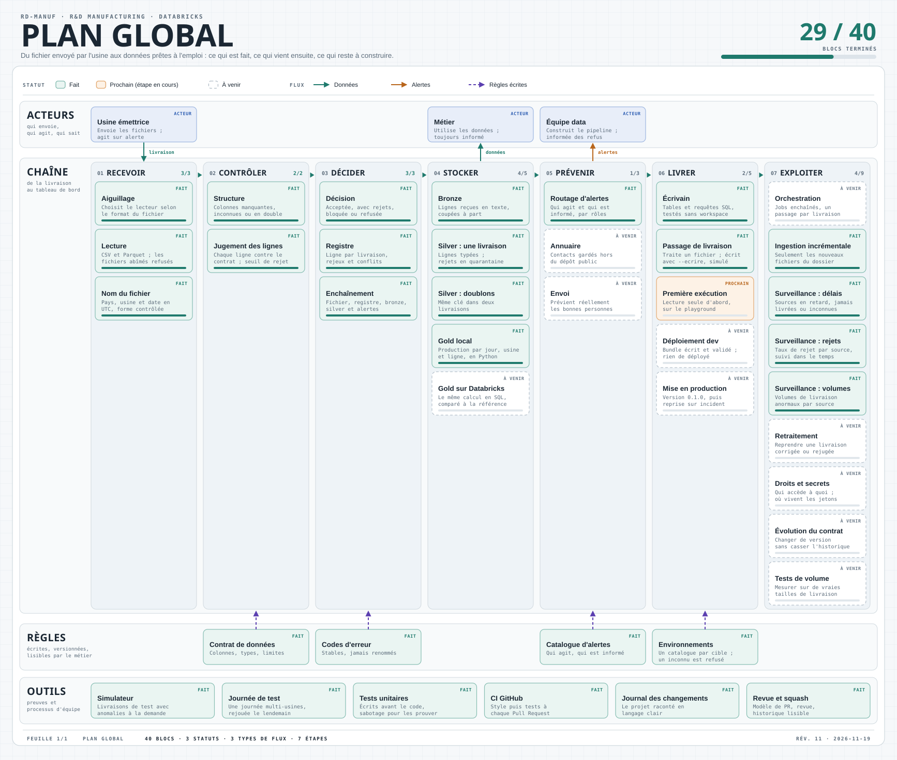

# rd-manuf : des données industrielles sous contrôle

**Qualité, gouvernance et traçabilité de la donnée R&D Manufacturing.**
Démonstration d'un workflow de data engineering, construit pas à pas avec un processus d'équipe : branches, Pull Requests, CI GitHub Actions et revue de code.

Le projet ne se résume pas à une architecture de stockage : un contrat de données lisible par le métier, un contrôle à la réception de chaque livraison, une traçabilité de ce qui est accepté, bloqué ou refusé, des alertes routées par rôle, une surveillance de la fraîcheur et du taux de rejet, et des preuves de test. Les données sont rangées en bronze → silver → gold sur Databricks ; c'est le moyen, pas le sujet.

## En clair

Des usines envoient des fichiers de données de production, appelés « livraisons ». Ce projet vérifie chaque livraison avant de s'en servir :
le fichier est-il lisible, a-t-il les bonnes colonnes, chaque valeur respecte-t-elle les règles prévues ?
Une ligne incorrecte est écartée au lieu d'être utilisée, une livraison trop abîmée est refusée,
et le projet détermine qui doit agir (l'usine émettrice, le métier ou l'équipe data) et qui doit seulement être informé.
Les règles sont écrites dans un « contrat de données », un fichier lisible par le métier.
Chaque livraison laisse une trace (acceptée, avec rejets, bloquée, refusée ou rejouée), les données valides alimentent un premier indicateur de production, et une surveillance repère les usines qui n'envoient plus rien ou dont le taux de rejet dérive.
Le code est testé en local, notamment sur une journée simulée de trois pays ; rien n'a encore tourné sur un vrai workspace.

<p align="center">
  <a href="docs/plan-global.svg">
    
  </a>
</p>

<p align="center"><sub>Cliquer sur l'image pour l'ouvrir en grand.</sub></p>

## Plan global

🚧 Projet en construction. 🟢 fait (logique écrite et testée) · 🟠 prochain · ⚪ à venir. Rien n'a encore tourné sur un workspace : le code d'écriture existe et est testé, mais n'a jamais été lancé. Cliquez sur une étape pour la déplier : les blocs terminés renvoient vers le code.

<details>
<summary><b>01 · Recevoir</b> : lire le fichier de l'usine</summary>

- 🟢 **Aiguillage** ([`lecture.py`](src/rd_manuf/lecture.py), [`reception.py`](src/rd_manuf/reception.py)) : le nom du fichier choisit le lecteur (CSV ou Parquet) ; une fonction enchaîne tout.
- 🟢 **Lecture** ([`lecture.py`](src/rd_manuf/lecture.py)) : lit le CSV et le Parquet ; un fichier abîmé, coupé ou mal encodé est refusé proprement.
- 🟢 **Nom du fichier** ([`nom_fichier.py`](src/rd_manuf/nom_fichier.py)) : pays, usine (`AA`), ligne de production (`001`) et instant UTC, contrôlés avant toute lecture ; un nom invalide est refusé.

</details>

<details>
<summary><b>02 · Contrôler</b> : la structure, puis chaque ligne</summary>

- 🟢 **Structure** ([`structure.py`](src/rd_manuf/structure.py)) : colonnes manquantes, inconnues ou en double, fichier vide.
- 🟢 **Jugement des lignes** ([`contrat.py`](src/rd_manuf/contrat.py)) : chaque ligne contre le contrat (une date n'a pas d'heure) ; trop de rejets bloquent la livraison.

</details>

<details>
<summary><b>03 · Décider</b> : une décision unique par livraison</summary>

- 🟢 **Décision** ([`reception.py`](src/rd_manuf/reception.py)) : acceptée, acceptée avec rejets, bloquée ou refusée.
- 🟢 **Registre** ([`registre.py`](src/rd_manuf/registre.py)) : une ligne par livraison (décision, origine, arrivée) ; un rejeu identique est ignoré, un contenu différent refusé.
- 🟢 **Enchaînement** ([`pipeline.py`](src/rd_manuf/pipeline.py)) : du fichier reçu au registre, au bronze, au silver et aux alertes, en un appel ; l'état reste chez l'appelant.

</details>

<details>
<summary><b>04 · Stocker</b> : bronze, silver, gold</summary>

- 🟢 **Bronze** ([`bronze.py`](src/rd_manuf/bronze.py)) : les lignes reçues, en texte, avec leur traçabilité ; les lignes coupées d'un CSV sont gardées à part.
- 🟢 **Silver : une livraison** ([`silver.py`](src/rd_manuf/silver.py)) : les lignes typées ; les rejetées vont en quarantaine ; il décide comme la réception.
- 🟢 **Silver : doublons** ([`silver.py`](src/rd_manuf/silver.py)) : un lot (pays, usine, numéro) déjà intégré par une livraison plus ancienne : même contenu ignoré, sinon quarantaine.
- 🟢 **Gold local** ([`gold.py`](src/rd_manuf/gold.py)) : la production par jour, pays, usine et ligne de fabrication, calculée en Python depuis le silver ; la table est décrite, pas encore créée.
- ⚪ **Gold sur Databricks** : le même calcul en SQL, comparé à la référence Python sur la journée de test.

</details>

<details>
<summary><b>05 · Prévenir</b> : qui agit, qui est informé</summary>

- 🟢 **Routage d'alertes** ([`alertes.py`](src/rd_manuf/alertes.py), [`catalogue.yaml`](contracts/alertes/catalogue.yaml)) : qui agit et qui est informé (des rôles), y compris pour un lot déjà intégré autrement.
- ⚪ **Annuaire** : les contacts, gardés hors du dépôt public.
- ⚪ **Envoi** : prévenir réellement les bonnes personnes (rien n'est encore envoyé).

</details>

<details>
<summary><b>06 · Livrer</b> : du bac à sable à la production</summary>

- 🟢 **Écrivain** ([`ecriture.py`](src/rd_manuf/ecriture.py), [`executeur_databricks.py`](src/rd_manuf/executeur_databricks.py)) : écrit et relit les cinq tables en SQL ; testé sans workspace.
- 🟢 **Passage de livraison** ([`passage.py`](src/rd_manuf/passage.py)) : traite un fichier avec le pipeline et l'écrit dans les tables du playground avec `--ecrire` ; simulation par défaut ; testé sans workspace.
- 🟠 **Première exécution** ([`sondage.py`](src/rd_manuf/sondage.py)) : en lecture seule sur le playground : essais de conversion, présence de nos tables. Pas encore lancé.
- ⚪ **Déploiement dev** ([`databricks.yml`](databricks.yml)) : trois cibles reliées à leurs catalogues, validées par Databricks ; rien n'est déployé.
- ⚪ **Mise en production** : version 0.1.0, puis reprise sur incident.

</details>

<details>
<summary><b>07 · Exploiter</b> : faire tourner et surveiller le pipeline</summary>

- ⚪ **Orchestration** : les étapes enchaînées en jobs Databricks, un passage par livraison.
- 🟢 **Ingestion incrémentale** ([`ingestion.py`](src/rd_manuf/ingestion.py)) : du dossier d'arrivée, seuls les fichiers que le registre n'a pas déjà vus (même nom, même contenu). Pas encore de programme.
- 🟢 **Surveillance : délais** ([`surveillance.py`](src/rd_manuf/surveillance.py)) : les sources en retard, jamais livrées, ou inconnues ; des constats, sans envoi.
- 🟢 **Surveillance : rejets** ([`surveillance.py`](src/rd_manuf/surveillance.py)) : le taux de rejet de chaque source sur ses dernières livraisons, comparé à une part du seuil du contrat ; des constats, sans envoi.
- 🟢 **Surveillance : volumes** ([`surveillance.py`](src/rd_manuf/surveillance.py)) : le volume de la dernière livraison de chaque source, comparé à la médiane de ses précédentes ; des constats, sans envoi.
- 🟢 **Retraitement** ([`retraitement.py`](src/rd_manuf/retraitement.py)) : choisir les livraisons à rejuger sous un autre contrat, les rejuger depuis le bronze, signaler le reclassement ; sans écriture.
- ⚪ **Droits et secrets** : qui accède à quoi (catalogues), et où vivent les jetons.
- ⚪ **Évolution du contrat** : changer de version sans casser l'historique ni les lignes déjà intégrées.
- ⚪ **Tests de volume** : mesurer le pipeline sur de vraies tailles de livraison, pour choisir entre Python et Spark.

</details>

<details>
<summary><b>Règles écrites et outils</b> : ce qui garantit la qualité</summary>

- 🟢 **Contrat de données** ([`livraison_production.yaml`](contracts/data/livraison_production.yaml)) : colonnes, types, limites et règles, lisibles par le métier ; version 2.0.0.
- 🟢 **Codes d'erreur** : stables, jamais renommés, car les alertes s'appuient dessus.
- 🟢 **Environnements** ([`config.py`](src/rd_manuf/config.py)) : un catalogue par cible (playground, dev, prod) ; un catalogue inconnu est refusé.
- 🟢 **Simulateur** ([`simulateur.py`](src/rd_manuf/simulateur.py)) : fabrique des livraisons de test (CSV ou Parquet, noms, numéros de lot) avec des anomalies et des fichiers abîmés demandés, pour rejouer un incident.
- 🟢 **Journée de test** ([`journee.py`](src/rd_manuf/journee.py)) : joue des livraisons de trois pays sur l'enchaînement, puis les rejoue le lendemain, et vérifie que l'état reste cohérent.
- 🟢 **Tests, CI et revue** ([`tests/unitaires/`](tests/unitaires/), [`.github/`](.github/)) : tests avant le code, CI à chaque PR, environnement conda en une commande.
- 🟢 **Journal des changements** ([`CHANGELOG.md`](CHANGELOG.md)) : le projet raconté pas à pas, en langage clair.

</details>

## Environnements (catalogues Unity Catalog)

| Environnement | Catalogue | Rôle |
|---|---|---|
| playground | `rd_manuf_playground` | Tests destructifs et scénarios libres |
| dev | `rd_manuf_dev` | Intégration sur les livraisons rejouées de la prod |
| prod | `rd_manuf_prod` | Production |

## Principe

Le dépôt contient le **code** ; les catalogues contiennent les **données**. Le même code tourne partout :
l'environnement se choisit par le paramètre `catalogue`, jamais par une copie de dossier.

## Organisation du dépôt

- [`contracts/data/`](contracts/data/) : le contrat de données de la livraison de production (colonnes, types, limites, règles).
- [`contracts/alertes/`](contracts/alertes/) : pour chaque code d'erreur, le rôle qui agit et ceux qui sont informés.
- [`src/rd_manuf/`](src/rd_manuf/) : le code.
  - `contrat.py` : chargement du contrat, contrôle des lignes et des livraisons, codes d'erreur ;
  - `structure.py` : contrôle de l'en-tête d'une livraison ;
  - `reception.py` : la décision unique sur une livraison, et la réception d'un fichier (nom, lecture, décision) ;
  - `nom_fichier.py` : la convention de nom des fichiers livrés ;
  - `registre.py` : la ligne de registre de chaque livraison, et la détection des rejeux ;
  - `bronze.py` : les lignes bronze d'une livraison, copiées en texte avec leur traçabilité, et ses lignes coupées conservées à part ;
  - `pipeline.py` : l'enchaînement d'une livraison, du fichier reçu au registre, au bronze, au silver et aux alertes, sans rien écrire ;
  - `silver.py` : les lignes valides typées et la quarantaine d'une livraison, rejugées depuis le bronze comme à la réception ;
  - `tables.py` : les schémas des cinq tables (registre, bronze, lignes coupées, silver, quarantaine) et leur SQL de création, sans rien écrire ;
  - `ecriture.py` : l'écrivain, sans workspace : les conversions lignes ↔ tables, un magasin en mémoire ou en SQL, et l'état adossé à un magasin ;
  - `executeur_databricks.py` : l'exécuteur réel : envoie les requêtes de l'écrivain à un entrepôt SQL Databricks et rend des lignes typées ; une requête interrompue au clavier est annulée côté entrepôt ;
  - `sondage.py` : la première exécution sur un workspace, en lecture seule : des essais de conversion et la présence de nos tables, avec le délai réglable, les durées affichées et l'interruption propre ;
  - `passage.py` : le passage d'une livraison dans les tables du playground : traitée avec le pipeline, puis écrite seulement avec `--ecrire` ;
  - `retraitement.py` : le retraitement : choisir les livraisons à rejuger sous une autre version du contrat, les rejuger depuis le bronze, et signaler leur reclassement (fonctions pures) ;
  - `ingestion.py` : l'ingestion incrémentale : parmi les fichiers d'un dossier d'arrivée, ceux que le registre n'a pas déjà vus, traités dans l'ordre des noms par `passer` ;
  - `gold.py` : la production par jour, pays, usine et ligne de fabrication, calculée depuis le silver (une fonction pure, sans écrire) ;
  - `surveillance.py` : la fraîcheur des livraisons (les sources qui n'ont pas livré à temps), le taux de rejet dans le temps et les volumes de livraison, comparés au registre (fonctions pures) ;
  - `alertes.py` : le routage des alertes selon le catalogue ;
  - `lecture.py` : lecture des fichiers CSV et Parquet, et choix du lecteur selon le format ;
  - `lecture_yaml.py` : la lecture des fichiers YAML du dépôt (contrat, catalogue d'alertes, sources attendues), qui refuse une clé répétée au lieu de garder la dernière ;
  - `simulateur.py` : fabrication de livraisons de test (lignes, numéros de lot, noms de fichiers, CSV et Parquet, fichiers abîmés) ;
  - `journee.py` : une journée multi-usines jouée sur l'enchaînement, avec l'état cumulé et les invariants qui doivent rester vrais ;
  - `config.py` : garde-fou sur le choix de l'environnement.
- [`tests/unitaires/`](tests/unitaires/) : les tests.
- [`docs/`](docs/) : l'image du plan global et le programme qui la fabrique.
- [`environment.yml`](environment.yml) : l'environnement conda de travail.
- [`databricks.yml`](databricks.yml) : le bundle Databricks, qui relie chaque cible de déploiement à son catalogue.
- [`.github/`](.github/) : la CI et le modèle de description des Pull Requests.

## Installer et lancer les tests

Il faut Python 3.12 ou plus récent. Le plus simple est de passer par conda, qui crée un environnement isolé. Les commandes se lancent **depuis la racine du dépôt**, car l'installation désigne le dossier courant :

```bash
conda env create -f environment.yml   # crée l'environnement « rd-manuf » : Python 3.12, le projet et ses outils de test
conda activate rd-manuf               # l'active (à refaire dans chaque nouveau terminal)
python -m pytest                      # lance les tests
ruff check src tests                  # vérifie le style du code (les mêmes dossiers que la CI)
mypy                                  # vérifie les types du code, en mode strict
python -m pytest --cov                # lance les tests et mesure la couverture : la CI l'exige à 100 %
```

Après un changement de dépendances dans `pyproject.toml`, on met l'environnement à jour avec `conda env update -f environment.yml --prune`.
Sans conda, `pip install -e ".[dev]"` installe la même chose dans l'environnement Python de son choix.

La liste des dépendances reste dans `pyproject.toml` : `environment.yml` ne fournit que Python et lance la même installation que la CI.
Un test vérifie que la version de Python y est la même que dans le projet et dans la CI.
La CI lance ces vérifications (style, types, puis tests avec leur couverture) à chaque Pull Request, sur un environnement neuf.
Le contrôle des types est strict sur `src` : sa configuration est dans `pyproject.toml`, et un test garde que la CI le lance et qu'aucun réglage ne l'assouplit en silence.
La couverture de test est exigée à **100 %**, en lignes et en branches (`pyproject.toml`) ; sans le SDK Databricks (que `.[dev]` installe), les tests de l'exécuteur sont ignorés et ce seuil ne peut pas être atteint. Un test garde la CI, le seuil et les exclusions : un `# pragma: no cover` dans le code n'est accepté que s'il est décidé et écrit dans `tests/unitaires/test_couverture.py`. Le fichier `.coverage` créé à la racine est ignoré par Git.

## Databricks : le bundle

Le fichier [`databricks.yml`](databricks.yml) décrit **où** le projet se déploie : trois cibles, `playground` (par défaut), `dev` et `prod`, chacune reliée à son catalogue de données. C'est la mise en œuvre du principe du dépôt : le même code partout, l'environnement choisi par le catalogue. Les noms de catalogues ne sont connus que de `src/rd_manuf/config.py`, et un test garde les deux d'accord.

Le fichier ne contient **ni adresse de workspace ni secret** : le dépôt est public, la CLI utilise le profil local de la personne qui lance la commande.
Rien n'est encore déployé : on valide seulement le bundle. Les commandes se lancent **depuis la racine du dépôt**, là où se trouve `databricks.yml`.

```bash
databricks auth login --host ADRESSE_DU_WORKSPACE   # une fois : ouvre un navigateur et enregistre un profil local
databricks bundle validate                          # vérifie le bundle, cible par défaut (playground), sans rien déployer
databricks bundle validate -t dev                   # idem pour une autre cible (dev, prod)
```

Remplacer `ADRESSE_DU_WORKSPACE` par l'adresse du workspace (de la forme `https://…`, sans rien après le nom de domaine). Il faut la CLI Databricks en version 0.218 ou plus récente.

## Databricks : la première exécution (lecture seule)

Le programme [`sondage.py`](src/rd_manuf/sondage.py) ne crée ni n'écrit rien : il n'envoie que des requêtes de lecture (`SELECT`). Il vérifie que les valeurs rendues par un entrepôt SQL ont bien les types attendus par le code, puis dit si nos trois schémas et nos cinq tables existent déjà dans le catalogue playground. « Absent » veut dire absent pour votre profil, qui ne voit que ce sur quoi il a des droits, et une vue de même nom compte comme présente.
Il faut le SDK Databricks (`pip install -e ".[databricks]"`), un profil de connexion et l'identifiant d'un entrepôt SQL : le dépôt est public, ni l'un ni l'autre n'y est écrit, ils se donnent à chaque lancement. Depuis la racine du dépôt :

```bash
python -m rd_manuf.sondage --profil NOM_DU_PROFIL --entrepot IDENTIFIANT_DE_L_ENTREPOT
```

Option : `--delai 300` pour laisser cinq minutes à chaque requête.

Le programme annonce d'abord « Connexion à l'entrepôt… » avec le délai de chaque requête : un entrepôt arrêté peut mettre du temps à démarrer, ce n'est pas un blocage. Ce délai est de 120 secondes par défaut (un choix prudent, pas une mesure) ; `--delai SECONDES` le change, et doit être un nombre fini et positif. La connexion, puis chaque essai, affichent leur durée en fin de ligne (`(1,5 s)`), ce qui donne les premières mesures réelles. Les requêtes sont envoyées en mode asynchrone : chacune attend au moins une pause de 2 secondes avant sa première interrogation, ce qui ajoute une vingtaine de secondes à un sondage complet. Ce mode d'envoi n'a pas encore été vu sur un vrai service.

Si la connexion échoue, le programme affiche l'erreur avec le temps passé (`Connexion impossible après 120,0 s : …`) puis ce qu'il faut vérifier : le nom du profil, l'identifiant de l'entrepôt, que l'entrepôt est démarré, et qu'il reste du quota ou des crédits de calcul (c'est ce qui bloque un entrepôt de la Free Edition une fois le quota du jour épuisé). Si le SDK n'est pas installé, seule la commande d'installation est affichée.

`Ctrl+C` interrompt le sondage : la requête en cours est annulée côté entrepôt, y compris pendant que l'entrepôt démarre, le programme dit que rien n'a été créé ni écrit, et sort avec le code 130. Seul l'instant de l'envoi lui-même, de l'ordre de la milliseconde, n'a pas encore d'identifiant à annuler. Un second `Ctrl+C` pendant l'annulation l'interrompt : la requête peut alors rester en file côté entrepôt, sans rien écrire.

Le code de sortie est 0 si tout est conforme, 1 si un essai ou la vérification de présence a échoué, 2 si le lancement est refusé (tout catalogue autre que le playground est refusé avant toute connexion) ou si la connexion échoue, 130 si vous l'avez interrompu. Le résultat s'affiche dans le terminal seulement : le relire avant de le coller dans une PR, il peut citer des noms propres à votre espace de travail.

## Databricks : passer une livraison dans les tables (simulation par défaut)

Le programme [`passage.py`](src/rd_manuf/passage.py) traite **une livraison** avec le pipeline et, seulement si on le demande, l'écrit dans les tables du catalogue playground. Même principe que le sondage : le profil de connexion et l'identifiant de l'entrepôt se donnent à chaque lancement, rien n'est lu ailleurs, et seul le playground est accepté (dev et prod sont refusés avant toute connexion). Il faut le SDK Databricks (`pip install -e ".[databricks]"`). Depuis la racine du dépôt :

```bash
python -m rd_manuf.passage --profil NOM_DU_PROFIL --entrepot IDENTIFIANT_DE_L_ENTREPOT --fichier CHEMIN_DE_LA_LIVRAISON
```

**Sans `--ecrire`, c'est une simulation** : il ne part que des lectures (`SELECT`), et le programme dit la décision (statut, lignes reçues, valides et rejetées, codes d'alerte, nombre de lignes par couche) sans rien créer ni écrire. Si des tables manquent (ou ne sont pas visibles pour ce profil), la simulation le dit, liste lesquelles et part d'un **état supposé vide** : la décision affichée peut alors différer de celle d'un état réel. Une lecture qui échoue alors que les tables existent est, elle, une erreur (code 1). **Avec `--ecrire`**, il crée les schémas et les tables s'ils manquent, puis écrit les couches de données d'abord et le registre en dernier.

La sortie ne montre aucune valeur de ligne, seulement des comptes et des codes. Le **code de sortie** est 0 si la livraison a été traitée, quel que soit son statut (une livraison refusée ou bloquée est un traitement correct, avec ses alertes), 1 si la création, la lecture, le traitement ou l'écriture échoue, 2 si le lancement est refusé (catalogue, fichier, contrat, heure ou connexion), 130 si vous l'interrompez. `--delai` règle le délai de chaque requête (120 secondes par défaut, comme pour le sondage).

**L'heure d'arrivée** est affichée à chaque lancement, en UTC, et ce qui est affiché est exactement ce qui sert de clé (`--heure-arrivee`, avec fuseau, la fixe ; maintenant, tronqué à la seconde, par défaut ; les microsecondes d'une heure donnée sont affichées). La clé du registre est le nom du fichier et cette heure : relancer une livraison **interrompue ou en panne avec la même heure** la reprend sans rien dupliquer, alors que la même livraison repassée à une autre heure est un rejeu, enregistré comme tel. Le programme redonne la commande de reprise quand l'écriture échoue. Si l'écriture est refusée parce qu'une livraison plus ancienne a des lignes sans registre, il le dit, ne dit pas de relancer la même commande (rien n'a été écrit), et demande de reprendre d'abord la livraison citée, avec son heure d'arrivée. Aucun lancement réel n'a encore eu lieu : seul le premier dira ce que rend le service.

## Gold local : la production par jour

Le module [`gold.py`](src/rd_manuf/gold.py) calcule, depuis les lignes du silver, une ligne par **pays, usine, ligne de fabrication et jour de production** : le nombre de lots, la production et le rebut totaux, le taux de rebut, et la température (moyenne, minimum, maximum sur les seules mesures présentes). Le taux se calcule sur les sommes, pas en moyennant les taux des lots ; une production nulle donne un taux vide ; la température n'est pas arrondie. C'est une fonction pure : elle n'écrit rien, et le gold se recalcule en entier depuis le silver. Sur la journée de test, depuis la racine du dépôt :

```python
from pathlib import Path
from tempfile import TemporaryDirectory

from rd_manuf.alertes import charger_catalogue
from rd_manuf.contrat import charger_contrat
from rd_manuf.gold import calculer_production_quotidienne
from rd_manuf.journee import Etat, jouer, journee_multi_usines

contrat = charger_contrat(Path("contracts/data/livraison_production.yaml"))
catalogue = charger_catalogue(Path("contracts/alertes/catalogue.yaml"))
etat = Etat()
with TemporaryDirectory() as dossier:
    jouer(contrat, catalogue, journee_multi_usines(contrat), Path(dossier), etat)
for ligne in calculer_production_quotidienne(etat.lignes_silver)[:3]:
    print(ligne)
```

Les valeurs de la journée de test sont fabriquées par le simulateur : ce ne sont pas des chiffres réels. La table `gold.production_quotidienne` est décrite dans [`tables.py`](src/rd_manuf/tables.py) mais pas encore créée : le calcul en SQL sur Databricks, comparé à cette référence, est un bloc à part.

## Surveillance : la fraîcheur des livraisons

Le pipeline ne réagit qu'aux fichiers qui arrivent : une usine qui n'envoie plus rien ne déclenche aucune alerte. Le fichier [`contracts/surveillance/sources_attendues.yaml`](contracts/surveillance/sources_attendues.yaml) déclare donc les sources attendues (pays, usine, ligne de production, comme dans le nom du fichier) et le délai maximal, en heures, entre deux livraisons. Il est relu en Pull Request, comme un contrat ; la ligne de production s'y écrit **entre guillemets** (`"001"`), sans quoi YAML la lit comme le nombre 1. Les valeurs du dépôt sont synthétiques.

La fonction `controler_fraicheur` ([`surveillance.py`](src/rd_manuf/surveillance.py)) compare le registre à l'instant « maintenant » (avec fuseau) et rend des constats :

- `LIVRAISON_EN_RETARD` : la dernière livraison **intégrée** (acceptée, ou acceptée avec rejets) a plus que le délai maximal, strictement ;
- `AUCUNE_LIVRAISON_INTEGREE` : la source n'a jamais eu de livraison intégrée ; elle a peut-être livré, mais refusé ou bloqué ;
- `SOURCE_INCONNUE` : une origine livre sans être déclarée.

Une livraison bloquée, refusée ou rejouée ne rafraîchit pas une source : ses données n'ont pas atteint le silver. Chaque constat dit le statut de la livraison la plus récente, pour distinguer une usine silencieuse d'une usine dont les envois sont refusés. C'est une fonction pure : elle n'écrit rien et ne prévient personne (l'annuaire et l'envoi sont des blocs à venir). Il n'y a pas de calendrier : une usine arrêtée le week-end demande un délai qui le couvre. Sur la journée de test, depuis la racine du dépôt :

```python
from datetime import timedelta
from pathlib import Path
from tempfile import TemporaryDirectory

from rd_manuf.alertes import charger_catalogue
from rd_manuf.contrat import charger_contrat
from rd_manuf.journee import PREMIERE_ARRIVEE, Etat, jouer, journee_multi_usines
from rd_manuf.surveillance import charger_sources_attendues, controler_fraicheur

contrat = charger_contrat(Path("contracts/data/livraison_production.yaml"))
catalogue = charger_catalogue(Path("contracts/alertes/catalogue.yaml"))
sources = charger_sources_attendues(Path("contracts/surveillance/sources_attendues.yaml"))
etat = Etat()
with TemporaryDirectory() as dossier:
    jouer(contrat, catalogue, journee_multi_usines(contrat), Path(dossier), etat)
for constat in controler_fraicheur(etat.registre, sources, PREMIERE_ARRIVEE + timedelta(hours=30)):
    print(constat)
```

## Surveillance : le taux de rejet dans le temps

Une livraison dont le taux de rejet dépasse le seuil du contrat est déjà **bloquée**, avec une alerte. Ce que la surveillance ajoute est la question que cette alerte pose au métier (« incident ponctuel ou dérive durable ? ») : le taux de chaque source **sur ses dernières livraisons**. Le seuil n'est pas inventé ici : c'est `taux_rejet_max` du [contrat de données](contracts/data/livraison_production.yaml), et le niveau de pré-alerte en est une **part**, donc il suit le contrat si celui-ci change. La section `taux_de_rejet` du fichier de surveillance règle cette part (`part_du_seuil`, de 0 exclu à 1 inclus) et la fenêtre (`fenetre_livraisons`, un entier d'au moins 1) ; les valeurs du dépôt sont un choix de départ, pas une mesure.

La fonction `controler_taux_de_rejet` ([`surveillance.py`](src/rd_manuf/surveillance.py)) rend un constat `TAUX_DE_REJET_ELEVE` par source dont le taux dépasse, strictement, `part × seuil` :

- le taux est celui des **sommes** (rejetés sur reçus, sur la fenêtre), jamais la moyenne des taux des livraisons ;
- une livraison **bloquée** compte : c'est le signal ; une livraison refusée ou rejouée n'a pas de taux et ne compte pas ;
- une source qui a moins de livraisons que la fenêtre n'est pas jugée : une pré-alerte sur une seule livraison serait du bruit ;
- le constat dit le taux, le niveau d'alerte, le seuil du contrat, le nombre de livraisons regardées et combien ont été bloquées.

C'est une fonction pure : elle n'écrit rien et ne prévient personne. Sur la journée de test, avec une fenêtre de 2 livraisons, depuis la racine du dépôt :

```python
from pathlib import Path
from tempfile import TemporaryDirectory

from rd_manuf.alertes import charger_catalogue
from rd_manuf.contrat import charger_contrat
from rd_manuf.journee import Etat, jouer, journee_multi_usines
from rd_manuf.surveillance import ParametresTauxRejet, controler_taux_de_rejet

contrat = charger_contrat(Path("contracts/data/livraison_production.yaml"))
catalogue = charger_catalogue(Path("contracts/alertes/catalogue.yaml"))
etat = Etat()
with TemporaryDirectory() as dossier:
    jouer(contrat, catalogue, journee_multi_usines(contrat), Path(dossier), etat)
parametres = ParametresTauxRejet(fenetre_livraisons=2, part_du_seuil=0.5)
for constat in controler_taux_de_rejet(etat.registre, parametres, contrat.taux_rejet_max):
    print(constat)
```

## Surveillance : les volumes de livraison

Une usine peut livrer à l'heure, sans un seul rejet, et pourtant envoyer la moitié de ses lignes (un export coupé en route) ou le double (un fichier envoyé deux fois) : ni la fraîcheur ni le taux de rejet ne le voient. La fonction `controler_volumes` ([`surveillance.py`](src/rd_manuf/surveillance.py)) compare le **volume** (le nombre de lignes reçues) de la dernière livraison de chaque source à la **médiane** de ses précédentes, et rend un constat `VOLUME_ANORMAL` quand l'écart relatif dépasse, strictement, `ecart_max`, en baisse comme en hausse :

- la référence est la médiane des `fenetre_livraisons` livraisons précédentes (la moyenne des deux valeurs du milieu pour une fenêtre paire), jamais leur moyenne : une livraison passée aberrante ne la dérègle pas ;
- comptent les mêmes livraisons que pour le taux de rejet : acceptée, acceptée avec rejets et bloquée, avec au moins une ligne reçue ; une livraison refusée ou rejouée n'est ni la dernière ni une référence ;
- une source qui a moins de `fenetre_livraisons` + 1 livraisons jugeables n'est pas jugée ;
- le constat dit le volume, la référence, l'écart (négatif pour une baisse), son sens, le nombre de livraisons de référence et l'identifiant de la livraison.

Les deux réglages sont dans la section `volumes` de [`sources_attendues.yaml`](contracts/surveillance/sources_attendues.yaml) : 5 livraisons de référence et un écart de 0,5 (la dernière livraison peut s'écarter de la moitié de la référence, en plus ou en moins). Ce sont des valeurs de départ, pas une mesure. Pas de calendrier : une usine qui livre moins le week-end demande un `ecart_max` qui le couvre. C'est une fonction pure : elle n'écrit rien et ne prévient personne. Sur la journée de test, avec une fenêtre d'une livraison, elle ne signale rien ; en triplant le volume de la dernière livraison d'une source, depuis la racine du dépôt :

```python
from dataclasses import replace
from pathlib import Path
from tempfile import TemporaryDirectory

from rd_manuf.alertes import charger_catalogue
from rd_manuf.contrat import charger_contrat
from rd_manuf.journee import Etat, jouer, journee_multi_usines
from rd_manuf.surveillance import ParametresVolumes, controler_volumes

contrat = charger_contrat(Path("contracts/data/livraison_production.yaml"))
catalogue = charger_catalogue(Path("contracts/alertes/catalogue.yaml"))
etat = Etat()
with TemporaryDirectory() as dossier:
    jouer(contrat, catalogue, journee_multi_usines(contrat), Path(dossier), etat)
parametres = ParametresVolumes(fenetre_livraisons=1, ecart_max=0.5)
print(controler_volumes(etat.registre, parametres))                   # []
registre = list(etat.registre)
derniere = max((ligne for ligne in registre if ligne.pays == "USA" and ligne.usine == "CA" and ligne.ligne == "001" and ligne.nb_recues),
               key=lambda ligne: ligne.heure_arrivee)
registre[registre.index(derniere)] = replace(derniere, nb_recues=derniere.nb_recues * 3)
for constat in controler_volumes(registre, parametres):
    print(constat)
```

## Retraitement : rejuger une livraison sous un autre contrat

Un contrat évolue (un seuil, une plage, une colonne), et les livraisons déjà intégrées ont été jugées sous l'ancienne version. Le module [`retraitement.py`](src/rd_manuf/retraitement.py) choisit celles à rejuger et dit ce que le nouveau jugement change. Il ne refait rien de ce que le code sait déjà : il enchaîne la réception, le registre et le silver sur ce que le bronze a gardé.

- `a_retraiter(registre, contrat)` rend, pour chaque livraison, sa **décision en vigueur** (sa dernière ligne de registre dont les lignes entrent au bronze : acceptée, acceptée avec rejets ou bloquée) quand elle a été jugée sous une **autre version** que celle du contrat donné. Un refus, un rejeu ou un conflit plus récent ne la remplace pas ;
- `retraiter(contrat, ligne, bronze, coupees, deja_integrees, heure)` rejuge la livraison depuis ses lignes bronze et ses lignes coupées, à une heure **postérieure à son arrivée** (la clé du registre est la livraison et l'heure), et rend la nouvelle ligne de registre, les lignes silver et la quarantaine du nouveau jugement, et un **reclassement** ;
- le reclassement (`LIVRAISON_RECLASSEE`) dit le statut, la version et les comptes avant et après ; il n'est rendu que si le statut ou les comptes changent. La structure est rejugée aussi : un contrat qui exige une colonne absente du bronze refuse la livraison.

Ce sont des fonctions pures : elles n'écrivent rien et ne préviennent personne. Elles ne disent pas non plus comment le nouveau jugement **remplace** l'ancien dans les tables : sans cette règle, ajouter ses lignes à côté des anciennes ferait compter deux fois la livraison. C'est l'objet de l'évolution du contrat. Sur la journée de test, avec un seuil de rejet à zéro, deux livraisons passent d'acceptée avec rejets à bloquée (`DEU_BA_001` et `USA_CA_002`) ; depuis la racine du dépôt :

```python
from dataclasses import replace
from datetime import UTC, datetime
from pathlib import Path
from tempfile import TemporaryDirectory

from rd_manuf.alertes import charger_catalogue
from rd_manuf.contrat import charger_contrat
from rd_manuf.journee import Etat, jouer, journee_multi_usines
from rd_manuf.retraitement import a_retraiter, retraiter

contrat = charger_contrat(Path("contracts/data/livraison_production.yaml"))
catalogue = charger_catalogue(Path("contracts/alertes/catalogue.yaml"))
etat = Etat()
with TemporaryDirectory() as dossier:
    jouer(contrat, catalogue, journee_multi_usines(contrat), Path(dossier), etat)
strict = replace(contrat, version="3.0.0", taux_rejet_max=0.0)           # un seuil à zéro : la moindre ligne rejetée bloque la livraison
heure = datetime(2026, 11, 20, 9, 0, tzinfo=UTC)
for ligne in a_retraiter(etat.registre, strict):
    cle = (ligne.livraison_id, ligne.heure_arrivee)
    bronze = [b for b in etat.lignes_bronze if (b.livraison_id, b.heure_arrivee) == cle]
    coupees = [c for c in etat.lignes_coupees if (c.livraison_id, c.heure_arrivee) == cle]
    resultat = retraiter(strict, ligne, bronze, coupees, etat.lignes_silver, heure)
    if resultat.reclassement is not None:
        print(resultat.reclassement)
```

## Travailler sur le projet

Le dépôt suit un processus d'équipe, même quand on y travaille seul :

1. une branche par ticket, créée depuis `main` à jour ;
2. le test d'abord, que l'on voit échouer avant d'écrire le code ;
3. des messages de commit au format *Conventional Commits* (`feat(lecture): ...`) ;
4. une Pull Request décrite avec le [modèle](.github/pull_request_template.md), dont la CI doit être verte ;
5. une revue avant de fusionner ;
6. une fusion en « squash » : le message qui reste dans l'historique de `main` est un texte brut en quatre parties (EN CLAIR, POURQUOI, CE QUI CHANGE, DÉCISIONS), compréhensible sans ouvrir la Pull Request ;
7. une entrée dans le [journal des changements](CHANGELOG.md), ajoutée par chaque Pull Request.

### Mettre à jour le plan global

L'image du plan est générée. Pour changer l'avancement, on modifie les statuts dans [`docs/generer_plan_global.py`](docs/generer_plan_global.py),
on lance `python docs/generer_plan_global.py`, puis on commite l'image régénérée. Un test vérifie que l'image et son générateur ne divergent pas.
Les sections ci-dessus se mettent à jour à la main, dans la même Pull Request.
